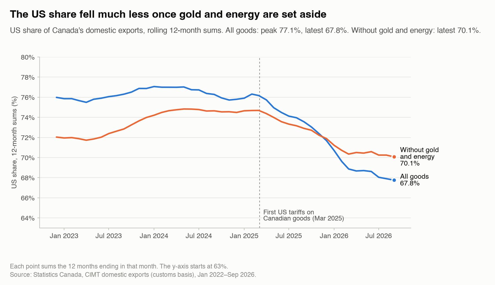
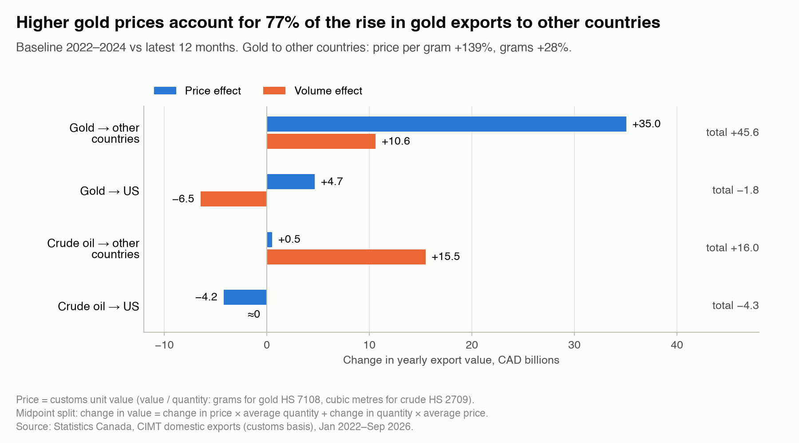

# Canada Export Diversification Under US Tariffs

**Short answer.** Since the 2025 US tariffs, the US share of Canada's goods exports fell by 8.4 percentage points, from 76.2% to 67.8%. Gold accounts for 56% of that drop (4.7 points), and most of the rise in gold exports is a price effect, not more gold shipped. Without gold and energy, the share fell only 3.3 points, and that smaller drop is linked mostly to growth in exports to other countries, not to a fall in exports to the US.


*Baseline 2022–2024 vs the latest 12 months (Oct 2025–Sep 2026). Gold and energy effects are the average of two removal orders.*

> Status: first results (H1 and H2). The product-level tests (H3, H4) and the sector exposure table come next.

## The question

How much of the drop in the US share of Canada's goods exports since the 2025 US tariffs is genuine diversification, and how much is gold and energy? Where is the genuine diversification, if any?

"US share" means exports to the United States divided by all of Canada's goods exports. It can fall for two reasons: Canada sells less to the US, or Canada sells more to everyone else.

## Scope

- **Goods only.** Canada's domestic exports, meaning goods grown, mined or made in Canada. Re-exports (foreign goods shipped out again) are left out.
- **Monthly, January 2022 to September 2026**, in Canadian dollars, by product (HS6, the 6-digit international product code) and destination country.
- **Baseline:** 2022–2024, with 2023–2024 as a check. **Tariff period:** the latest 12 months (Oct 2025–Sep 2026).
- **Front-loading left out.** November 2024 to February 2025 are excluded from both periods, because many firms shipped early to beat the expected tariffs.

**Out of scope:** causality, policy advice and forecasts; services; firm-level data; provinces; US or Mexican mirror data; and Canada's counter-tariffs on US goods (this project studies Canada's exports only).

## Data and validation

- **Main source:** Statistics Canada's Canadian International Merchandise Trade (CIMT) bulk files, at 5,382 product codes and 224 destinations (data downloaded 2026-11-06).
- **Other sources:** Statistics Canada tables, World Bank commodity prices, Bank of Canada exchange rates, and 29 US tariff events taken from primary US government documents.
- **Checks before any result:** totals are compared with published Statistics Canada tables (by country, by year and by month), the customs-based US share is compared with the balance-of-payments figure, and gold prices per gram are compared with World Bank prices. All halting checks passed for this data download. Details: [docs/validation_report.md](docs/validation_report.md).

## Method in plain words

1. **US share.** For each month, add up the last 12 months of exports to the US and to all other countries, then divide. Twelve-month sums remove seasonal swings.
2. **Baseline.** Each calendar month is averaged over the baseline years, then the 12 months are added. This keeps seasons balanced even though two front-loading months are left out.
3. **Which side moved (H1).** The change in the share is split into a US part and a rest-of-world part, using a standard log decomposition. If the simple version is off by more than 10%, an exact version is used.
4. **Gold and energy (H2).** The share is recomputed without gold, and without gold and energy. The differences are the gold and energy effects. Both removal orders are computed and averaged.
5. **Price or volume.** For gold and crude oil, the change in export value is split into a price part and a quantity part, using the value per gram (or per cubic metre) from the customs data.

All thresholds were fixed before looking at results ([config/settings.yaml](config/settings.yaml)). Full details: [docs/methodology.md](docs/methodology.md).

## Findings

### H1 · Is the drop linked more to other markets growing than to US exports falling? **Confirmed**

- Exports to the US went from CAD 549.2 billion a year in the baseline to CAD 529.5 billion in the latest 12 months (−3.6%).
- Exports to all other countries went from CAD 171.5 billion to CAD 251.9 billion (+46.9%). Gold accounts for CAD 45.6 billion of that CAD 80.4 billion increase (57%).
- About 91% of the change in the US share is on the rest-of-world side (10.7 log points vs 1.0 for the US side; exact form). The rule was: confirmed if the rest-of-world side is larger.
- Without gold and energy, exports to other countries changed +14.3% and exports to the US −3.0%. The rest-of-world side is still larger (81% of the change): **confirmed**.
- With the 2023–2024 baseline the results are the same: 93% (all goods) and 74% (without gold and energy) on the rest-of-world side.



### H2 · Without gold and energy, is the drop much smaller? **Confirmed**

**Two parts to the answer.**

1. **Gold explains more than half of the drop.** The US share changed −8.4 pp in total: gold −4.7 pp (56% of the drop), energy −0.4 pp on average, everything else −3.3 pp (40%). Shares may not sum to 100% due to rounding.
2. **Without gold and energy, the US share still fell 3.3 points.** That smaller drop is linked mostly to higher sales to other countries (81% of it is on the rest-of-world side; see H1), not to lower sales to the US.

- **Verdict.** The rule was: confirmed if the drop without gold and energy is at most 50% of the headline drop. It is 39.5%.
- **Sensitivity.** With the 2023–2024 baseline, the verdict is the same (confirmed), but the margin is thin: the drop without gold and energy is 48.5% of the headline (threshold 50%). The share fell 8.6 points: gold −4.7 pp, energy +0.3 pp, everything else −4.2 pp.
- **Removal order.** The gold effect ranges from −5.4 to −4.1 pp and the energy effect from −1.0 to +0.3 pp, depending on which is removed first. The average of both orders is reported.
- **Price or volume?** Gold exports to other countries rose by CAD 45.6 billion a year. 77% of that change (CAD 35.0 billion) is a price effect: the value per gram changed +139% and grams shipped +28%. Gold exports to the US fell by CAD 1.8 billion, with a volume effect of CAD −6.5 billion (grams −66%). Crude oil exports to other countries rose by CAD 16.0 billion, mostly volume (volume effect CAD +15.5 billion); crude to the US fell by CAD 4.3 billion, mostly price.
- **Crude oil context.** The rise in crude exports to other countries coincides with the expanded Trans Mountain pipeline, which started commercial service on May 1, 2024, before the US tariffs (Trans Mountain Corporation, a federal Crown corporation).



## Limitations

- **Description, not cause.** The results show what changed alongside the tariffs. They do not prove the tariffs caused it.
- **Gold is volatile.** Gold exports depend on world gold prices and on where bullion is refined and stored, so the gold effect can swing from year to year.
- **Customs basis.** Canada's exports to the US are measured with US import data under a Canada–US data exchange. The customs US share and the balance-of-payments share differ by at most 0.63 points in the periods checked (validation check V2).
- **Front-loading.** Exports surged before the tariffs. Those months are left out, but some early shipping may fall outside the excluded window.
- **Lumber and US tariffs in general.** Softwood lumber already paid US anti-dumping and countervailing duties before 2025, and across-the-board US tariffs applied to goods that did not qualify for USMCA. More detail: [docs/methodology.md](docs/methodology.md#limitations).

## How to reproduce

```bash
make setup   # Python 3.14 virtual environment and pinned packages
make all     # download → validate → build marts → figures → notebooks → reports → CSV
make test    # unit tests
```

Raw downloads are listed with checksums in [data/raw/MANIFEST.csv](data/raw/MANIFEST.csv). Notebooks: [01 H1](notebooks/01_h1_decomposition.ipynb), [02 H2](notebooks/02_h2_gold_energy_waterfall.ipynb).

## Sources

Every source, with its tier, URL and access date: [docs/sources.md](docs/sources.md).
