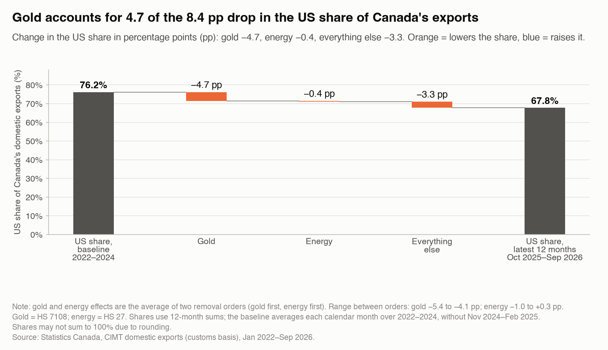
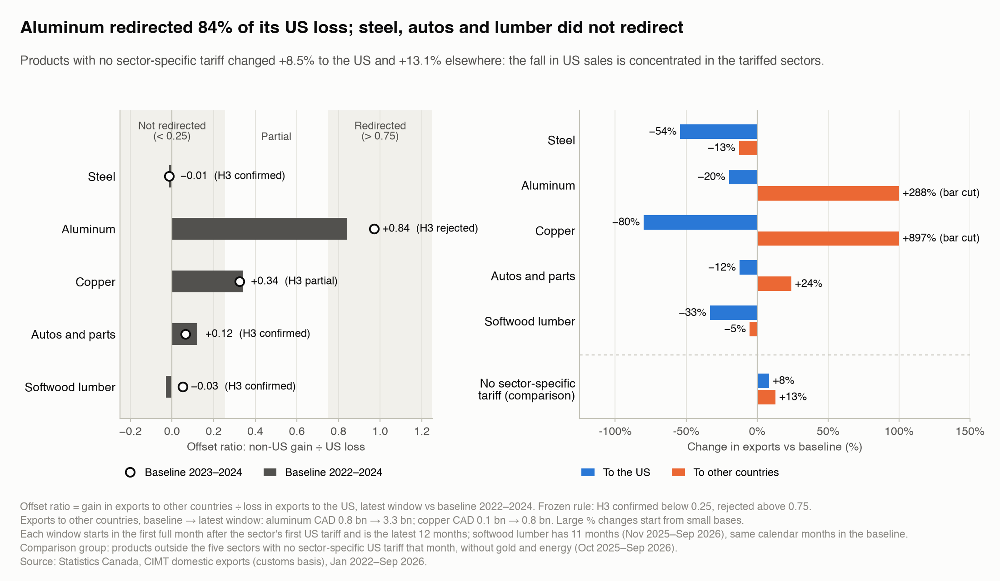
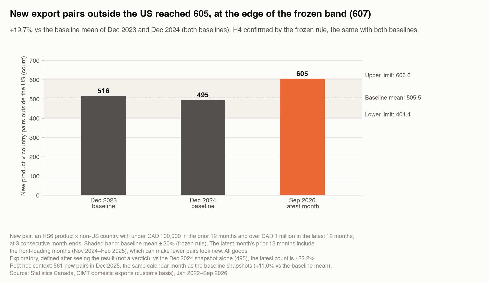
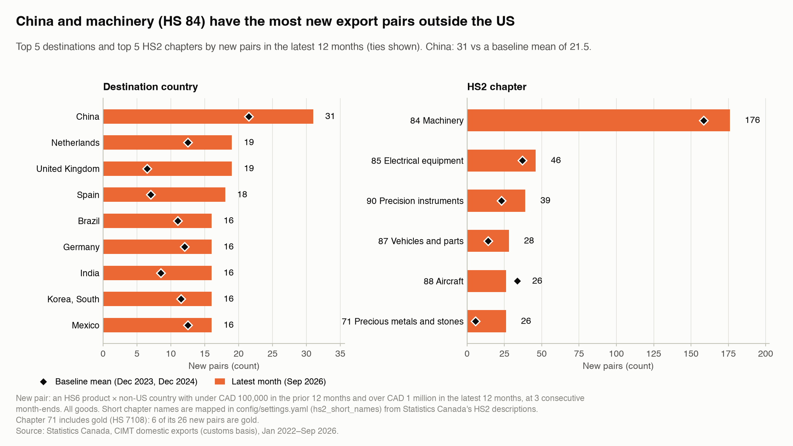
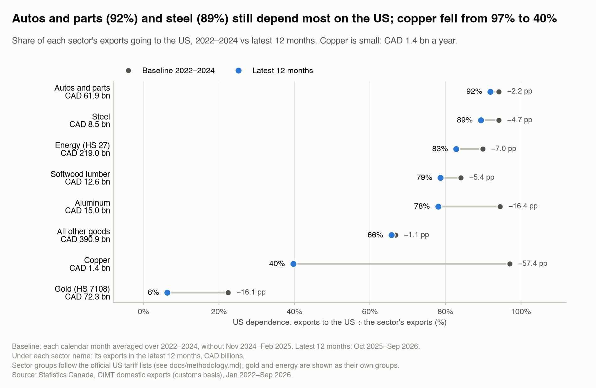

# Canada Export Diversification Under US Tariffs

**Short answer.** Since the 2025 US tariffs, the US share of Canada's goods exports fell by 8.4 percentage points, from 76.2% to 67.8%. Gold accounts for 56% of that drop (4.7 points), and most of the rise in gold exports is a price effect, not more gold shipped. Without gold and energy, the share fell only 3.3 points, and that smaller drop is linked mostly to growth in exports to other countries, not to a fall in exports to the US.

**Where the diversification is.** Among the five sectors with US tariffs, aluminum redirected most of its US loss to other markets (offset ratio 0.84); steel, autos and parts, and softwood lumber did not; copper partly did. Products with no sector-specific tariff sold 8.5% more to the US, so the fall in US sales is concentrated in the tariffed sectors. New product–country pairs outside the US reached 605, 19.7% above the baseline: confirmed by the frozen rule, but at the edge, so a moderate rise cannot be ruled out. Against the baseline, new pairs rose most in the United Kingdom (19 vs 6.5), Spain (18 vs 7.0) and China (31 vs 21.5); HS 84 machinery (176 vs 158.5) has the most new pairs.



*Baseline 2022–2024 vs the latest 12 months (Oct 2025–Sep 2026). Gold and energy effects are the average of two removal orders.*

> Status: all four hypotheses tested (H1–H4) plus the sector exposure table. Data to September 2026.

## The question

How much of the drop in the US share of Canada's goods exports since the 2025 US tariffs is genuine diversification, and how much is gold and energy? Where is the genuine diversification, if any?

"US share" means exports to the United States divided by all of Canada's goods exports. It can fall for two reasons: Canada sells less to the US, or Canada sells more to everyone else.

## Scope

- **Goods only.** Canada's domestic exports, meaning goods grown, mined or made in Canada. Re-exports (foreign goods shipped out again) are left out.
- **Monthly, January 2022 to September 2026**, in Canadian dollars, by product (HS6, the 6-digit international product code) and destination country.
- **Baseline:** 2022–2024, with 2023–2024 as a check. **Tariff period:** the latest 12 months (Oct 2025–Sep 2026).
- **Front-loading left out.** November 2024 to February 2025 are excluded from both periods, because many firms shipped early to beat the expected tariffs.

**Out of scope:** causality, policy advice and forecasts; services; firm-level data; provinces; US or Mexican mirror data; and Canada's counter-tariffs on US goods (this project studies Canada's exports only).

## Data and validation

- **Main source:** Statistics Canada's Canadian International Merchandise Trade (CIMT) bulk files, at 5,382 product codes and 224 destinations (data downloaded 2026-11-06).
- **Other sources:** Statistics Canada tables, World Bank commodity prices, Bank of Canada exchange rates, and 29 US tariff events taken from primary US government documents.
- **Checks before any result:** totals are compared with published Statistics Canada tables (by country, by year and by month), the customs-based US share is compared with the balance-of-payments figure, and gold prices per gram are compared with World Bank prices. All halting checks passed for this data download. Details: [docs/validation_report.md](docs/validation_report.md).

## Method in plain words

1. **US share.** For each month, add up the last 12 months of exports to the US and to all other countries, then divide. Twelve-month sums remove seasonal swings.
2. **Baseline.** Each calendar month is averaged over the baseline years, then the 12 months are added. This keeps seasons balanced even though two front-loading months are left out.
3. **Which side moved (H1).** The change in the share is split into a US part and a rest-of-world part, using a standard log decomposition. If the simple version is off by more than 10%, an exact version is used.
4. **Gold and energy (H2).** The share is recomputed without gold, and without gold and energy. The differences are the gold and energy effects. Both removal orders are computed and averaged.
5. **Price or volume.** For gold and crude oil, the change in export value is split into a price part and a quantity part, using the value per gram (or per cubic metre) from the customs data.
6. **Redirection (H3).** For each tariffed sector, the offset ratio divides the gain in exports to other countries by the loss in exports to the US. A ratio of 0.1 means 10 cents gained elsewhere for every dollar lost in the US. Each sector is measured from its own first tariff, against the same calendar months in the baseline.
7. **New export pairs (H4).** A product (HS6) and a non-US country form a new pair when exports go from under CAD 100,000 a year to over CAD 1 million a year, for three month-ends in a row. The count at the latest month is compared with the count at the end of 2023 and 2024.
8. **Sector exposure.** For each sector: the share of its exports that goes to the US, before and after, and how spread out its destinations are.

All thresholds were fixed before looking at results ([config/settings.yaml](config/settings.yaml)). Full details: [docs/methodology.md](docs/methodology.md).

## Findings

### H1 · Is the drop linked more to other markets growing than to US exports falling? **Confirmed**

- Exports to the US went from CAD 549.2 billion a year in the baseline to CAD 529.5 billion in the latest 12 months (−3.6%).
- Exports to all other countries went from CAD 171.5 billion to CAD 251.9 billion (+46.9%). Gold accounts for CAD 45.6 billion of that CAD 80.4 billion increase (57%).
- About 91% of the change in the US share is on the rest-of-world side (10.7 log points vs 1.0 for the US side; exact form). The rule was: confirmed if the rest-of-world side is larger.
- Without gold and energy, exports to other countries changed +14.3% and exports to the US −3.0%. The rest-of-world side is still larger (81% of the change): **confirmed**.
- With the 2023–2024 baseline the results are the same: 93% (all goods) and 74% (without gold and energy) on the rest-of-world side.


### H2 · Without gold and energy, is the drop much smaller? **Confirmed**

**Two parts to the answer.**

1. **Gold explains more than half of the drop.** The US share changed −8.4 pp in total: gold −4.7 pp (56% of the drop), energy −0.4 pp on average, everything else −3.3 pp (40%). Shares may not sum to 100% due to rounding.
2. **Without gold and energy, the US share still fell 3.3 points.** That smaller drop is linked mostly to higher sales to other countries (81% of it is on the rest-of-world side; see H1), not to lower sales to the US.

- **Verdict.** The rule was: confirmed if the drop without gold and energy is at most 50% of the headline drop. It is 39.5%.
- **Sensitivity.** With the 2023–2024 baseline, the verdict is the same (confirmed), but the margin is thin: the drop without gold and energy is 48.5% of the headline (threshold 50%). The share fell 8.6 points: gold −4.7 pp, energy +0.3 pp, everything else −4.2 pp.
- **Removal order.** The gold effect ranges from −5.4 to −4.1 pp and the energy effect from −1.0 to +0.3 pp, depending on which is removed first. The average of both orders is reported.
- **Price or volume?** Gold exports to other countries rose by CAD 45.6 billion a year. 77% of that change (CAD 35.0 billion) is a price effect: the value per gram changed +139% and grams shipped +28%. Gold exports to the US fell by CAD 1.8 billion, with a volume effect of CAD −6.5 billion (grams −66%). Crude oil exports to other countries rose by CAD 16.0 billion, mostly volume (volume effect CAD +15.5 billion); crude to the US fell by CAD 4.3 billion, mostly price.
- **Crude oil context.** The rise in crude exports to other countries coincides with the expanded Trans Mountain pipeline, which started commercial service on May 1, 2024, before the US tariffs (Trans Mountain Corporation, a federal Crown corporation).


### H3 · Did tariffed sectors sell less to the US without finding other buyers? **Confirmed for 3 of 5 sectors**

The rule, per sector: confirmed if the offset ratio is below 0.25, rejected above 0.75, partial in between. Each sector's window starts in the first full month after its first US tariff; softwood lumber has 11 months (Nov 2025–Sep 2026), compared with the same calendar months in the baseline.

| Sector | Window | To the US | To other countries | Offset ratio 2022–2024 | Offset ratio 2023–2024 |
|---|---|---:|---:|---:|---:|
| Steel | Oct 2025–Sep 2026 | −54% | −13% | −0.01 (confirmed) | −0.01 (confirmed) |
| Aluminum | Oct 2025–Sep 2026 | −20% | +288% | +0.84 (rejected) | +0.97 (rejected) |
| Copper | Oct 2025–Sep 2026 | −80% | +897% | +0.34 (partial) | +0.32 (partial) |
| Autos and parts | Oct 2025–Sep 2026 | −12% | +24% | +0.12 (confirmed) | +0.06 (confirmed) |
| Softwood lumber | Nov 2025–Sep 2026 | −33% | −5% | −0.03 (confirmed) | +0.05 (confirmed) |
| *No sector-specific tariff* (comparison, without gold and energy) | Oct 2025–Sep 2026 | +8% | +13% | not defined (US rose) | not defined (US rose) |

- **Redirected (H3 rejected): aluminum**, offset ratio 0.84. Exports to the US fell 20% (CAD 2.9 billion) while exports to other countries went from CAD 0.8 billion to 3.3 billion: about 84 cents gained elsewhere for every dollar lost in the US.
- **Not redirected (H3 confirmed): steel, autos and parts, and softwood lumber**, offset ratios −0.01 (steel), +0.12 (autos and parts), and −0.03 (softwood lumber). Exports to the US fell and exports to other countries did not make up for it.
- **Partial: copper**, offset ratio 0.34. Exports to the US fell 80% (CAD 2.2 billion); exports to other countries went from CAD 0.1 billion to 0.8 billion, a large % rise from a small base.
- **Comparison: the fall in US sales is concentrated in the tariffed sectors.** Products with no sector-specific US tariff, without gold and energy, changed +8.5% to the US and +13.1% to other countries over the same months (with gold and energy: +1.1% and +49.5%). Their exports to the US rose, so no offset ratio is defined for them.
- **Sensitivity.** With the 2023–2024 baseline the verdicts are the same for every sector (comparison group: +6.9% to the US, +16.0% elsewhere).



### H4 · Did new export pairs outside the US stay within the pre-tariff range? **Confirmed (both baselines), at the edge**

The rule: confirmed if the count at the latest month is within ±20% of the baseline mean; rejected if above. The baseline mean uses the two frozen snapshots, December 2023 and December 2024, for both baselines.

- **Confirmed by the frozen rule, but at the edge (605 vs a limit of 607). The front-loading bias pushes the count down, so this result cannot rule out a moderate rise in new export pairs.**
- In September 2026, 605 product–country pairs outside the US were new. The baseline mean is 505.5, so the band is 404–607 (upper limit 606.6). The count is 19.7% above the mean. The verdict is the same with both baselines.
- Without gold, and without gold and energy, the pattern is the same:

| Variant | Latest count | Baseline mean (Dec 2023, Dec 2024) | Band (mean ± 20%) | Change | Verdict, both baselines |
|---|---:|---:|---:|---:|---|
| All goods | 605 | 505.5 | 404.4–606.6 | +19.7% | confirmed |
| Without gold | 599 | 505.0 | 404.0–606.0 | +18.6% | confirmed |
| Without gold and energy | 592 | 495.5 | 396.4–594.6 | +19.5% | confirmed |

- **Front-loading pushes the count down.** The latest snapshot looks back at 12 months that include November 2024 to February 2025, when exports to non-US countries were 3.5% higher than a year earlier. A higher starting point makes fewer pairs look new.
- **Context only, not verdicts.** *Exploratory, defined after seeing the result:* against the Dec 2024 snapshot alone (495 pairs), the latest count is +22.2%. *Post hoc:* December 2025, the same calendar month as the baseline snapshots, had 561 new pairs (+11.0% vs the baseline mean).

**Where the new pairs rose most.** Against each destination's own baseline mean, the largest rises are in the United Kingdom (19 vs 6.5), Spain (18 vs 7.0) and China (31 vs 21.5). Gold is part of it: the United Kingdom's include 1 gold pair (HS 7108; 4 precious-metal pairs in chapter 71 in total) and Spain's include 1 gold pair. By product, HS 71 precious metals and stones (26 vs 5.5, 6 of them gold) rose most against its baseline, while HS 84 machinery (176 vs 158.5) still has the most new pairs (29% of the total). China has the most new pairs of any destination (31, baseline mean 21.5).

| Rank | Destination | New pairs | Baseline mean |
|---:|---|---:|---:|
| 1 | China | 31 | 21.5 |
| 2 | Netherlands | 19 | 12.5 |
| 2 | United Kingdom | 19 | 6.5 |
| 4 | Spain | 18 | 7.0 |
| 5 | Brazil | 16 | 11.0 |
| 5 | Germany | 16 | 12.0 |
| 5 | India | 16 | 8.5 |
| 5 | Korea, South | 16 | 11.5 |
| 5 | Mexico | 16 | 12.5 |

| Rank | HS2 chapter | Statistics Canada description | New pairs | Baseline mean |
|---:|---|---|---:|---:|
| 1 | 84 Machinery | Nuclear reactors, boilers, machinery and mechanical appliances; parts thereof | 176 | 158.5 |
| 2 | 85 Electrical equipment | Elec mchy,equip & pts;snd record & repro,tv image & snd record & repro,pts,acces | 46 | 37.0 |
| 3 | 90 Precision instruments | Inst & app for optical/photo/cine/meas/chk/precision/med/surg; parts & acces t/o | 39 | 23.0 |
| 4 | 87 Vehicles and parts | Vehicles, o/t railway or tramway rolling-stock,and parts and accessories thereof | 28 | 14.0 |
| 5 | 88 Aircraft | Aircraft, spacecraft, and parts thereof | 26 | 33.5 |
| 5 | 71 Precious metals and stones | Nat/cult pearls,prec/semi-prec stones,prec met,clad,art t/o;imitation jewel;coin | 26 | 5.5 |





### Sector exposure · How dependent is each sector on the US?

Descriptive only, no hypothesis test. Ordered by US dependence in the latest 12 months; baseline 2022–2024. HHI (destination concentration) is 1 when a sector sells to one country only.

| Sector | Share of exports, latest | US dependence, 2022–2024 | US dependence, latest | Change (pp) | Destination HHI, latest | Under a US sector tariff, latest (full / partial) |
|---|---:|---:|---:|---:|---:|---:|
| Autos and parts | 7.9% | 94.2% | 91.9% | −2.2 | 0.85 | 0% / 100% |
| Steel | 1.1% | 94.1% | 89.4% | −4.7 | 0.80 | 60% / 40% |
| Energy (HS 27) | 28.0% | 89.9% | 82.9% | −7.0 | 0.69 | 0% / 12% |
| Softwood lumber | 1.6% | 84.1% | 78.7% | −5.4 | 0.63 | 100% / 0% |
| Aluminum | 1.9% | 94.5% | 78.1% | −16.4 | 0.63 | 93% / 7% |
| All other goods | 50.0% | 66.8% | 65.7% | −1.1 | 0.44 | 18% / 16% |
| Copper | 0.2% | 97.1% | 39.7% | −57.4 | 0.24 | 0% / 100% |
| Gold (HS 7108) | 9.2% | 22.5% | 6.3% | −16.1 | 0.76 | 0% / 0% |

- Autos and parts (92%) and steel (89%) still depend most on the US.
- The largest change is in copper: from 97% to 40% of its exports going to the US. It is a small sector (CAD 1.4 billion of exports in the latest 12 months).
- "Under a US sector tariff" is the share of the sector's latest exports covered fully or partly by a sector-specific US measure in the latest month (partial = only some tariff lines or part of the value, for example USMCA content).



## Limitations

- **Description, not cause.** The results show what changed alongside the tariffs. They do not prove the tariffs caused it.
- **Gold is volatile.** Gold exports depend on world gold prices and on where bullion is refined and stored, so the gold effect can swing from year to year.
- **Customs basis.** Canada's exports to the US are measured with US import data under a Canada–US data exchange. The customs US share and the balance-of-payments share differ by at most 0.63 points in the periods checked (validation check V2).
- **Front-loading.** Exports surged before the tariffs. Those months are left out, but some early shipping may fall outside the excluded window.
- **New pairs need time.** A pair counts as new only after three month-ends above CAD 1 million, so flows that started recently are not counted yet. The H4 count sits 1.6 pairs below its upper limit, so small data revisions can change the verdict.
- **Comparison group still paid some duties.** Products with no sector-specific tariff that did not qualify for USMCA still paid across-the-board US duties (IEEPA, March 2025 to February 2026, then Section 122 and Section 301).
- **Lumber and US tariffs in general.** Softwood lumber already paid US anti-dumping and countervailing duties before 2025, and across-the-board US tariffs applied to goods that did not qualify for USMCA. More detail: [docs/methodology.md](docs/methodology.md#limitations).

## How to reproduce

```bash
make setup   # Python 3.14 virtual environment and pinned packages
make all     # download → validate → build marts → figures → notebooks → reports → CSV
make test    # unit tests
```

Raw downloads are listed with checksums in [data/raw/MANIFEST.csv](data/raw/MANIFEST.csv). Notebooks: [01 H1](notebooks/01_h1_decomposition.ipynb), [02 H2](notebooks/02_h2_gold_energy_waterfall.ipynb), [03 H3](notebooks/03_h3_redirection.ipynb), [04 H4](notebooks/04_h4_extensive_margin.ipynb), [05 sector exposure](notebooks/05_sector_exposure.ipynb). Analyst pack (Excel): [excel/analyst_pack.xlsx](excel/analyst_pack.xlsx).

## Sources

Every source, with its tier, URL and access date: [docs/sources.md](docs/sources.md).
