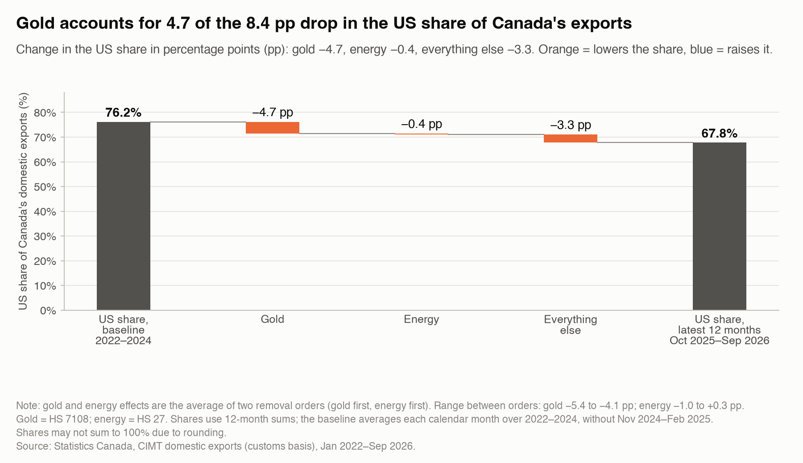

# Canada's exports after the 2025 US tariffs: gold accounts for 56% of the drop in the US share

Omar Serrano · Data Analyst · [GitHub] · [LinkedIn]

**Data:** Statistics Canada, CIMT domestic exports (customs basis), January 2022–September 2026. Baseline 2022–2024 vs the latest 12 months (Oct 2025–Sep 2026).

## Key findings

1. **The US share changed −8.4 pp, from 76.2% to 67.8%.**
2. **Gold −4.7 pp (56% of the drop),** energy −0.4 pp on average, everything else −3.3 pp (40%). Shares may not sum to 100% due to rounding.
3. **Gold: mostly price.** 77% of the CAD 45.6 bn rise in gold exports to other countries is a price effect; the volume of gold to the US fell (volume effect CAD −6.5 bn, grams −66%).
4. **Crude: mostly volume.** Crude oil exports to other countries rose by CAD 16.0 bn a year; 97% of that is a volume effect (CAD +15.5 bn). This coincides with the expanded Trans Mountain pipeline starting service on May 1, 2024, before the tariffs.
5. **H2 Confirmed.** Without gold and energy, the drop is 39.5% of the headline (frozen threshold: at most 50%). With the 2023–2024 baseline it is 48.5% against the 50% threshold (confirmed; thin margin).
6. **H1 Confirmed.** About 91% of the change is linked to faster growth in exports to other countries (CAD 171.5 bn → 251.9 bn a year, +46.9%). Exports to the US changed −3.6% (CAD 549.2 bn → 529.5 bn). Without gold and energy: 81% on the rest-of-world side (confirmed).

## How to read this

- The US share can fall because exports to the US shrink or because exports elsewhere grow. Here it is mostly the second. Gold accounts for 57% of the growth in exports to other countries (CAD 45.6 bn of 80.4 bn).
- Without gold and energy, the US share still fell 3.3 points, mostly on the rest-of-world side: exports to other countries changed +14.3%.
- These are associations, not proof that the tariffs caused the change.

## Method in one paragraph

Shares use 12-month sums. The baseline averages each calendar month over 2022–2024 and leaves out the front-loading months (November 2024–February 2025). Gold (HS 7108) and energy (HS 27) effects are the average of two removal orders; the gold effect ranges from −5.4 to −4.1 pp between orders. Thresholds were frozen before the analysis. All checks against published Statistics Canada tables passed (data downloaded 2026-11-06).

**Next:** product-level redirection in tariffed sectors (H3), new product–market pairs (H4) and a sector exposure table.
